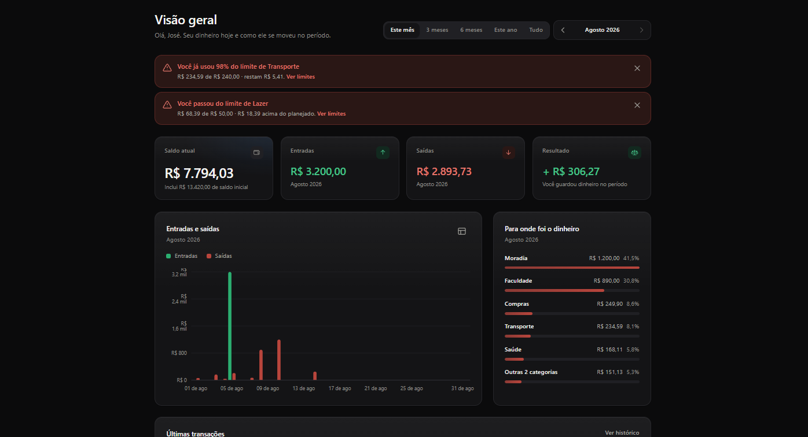
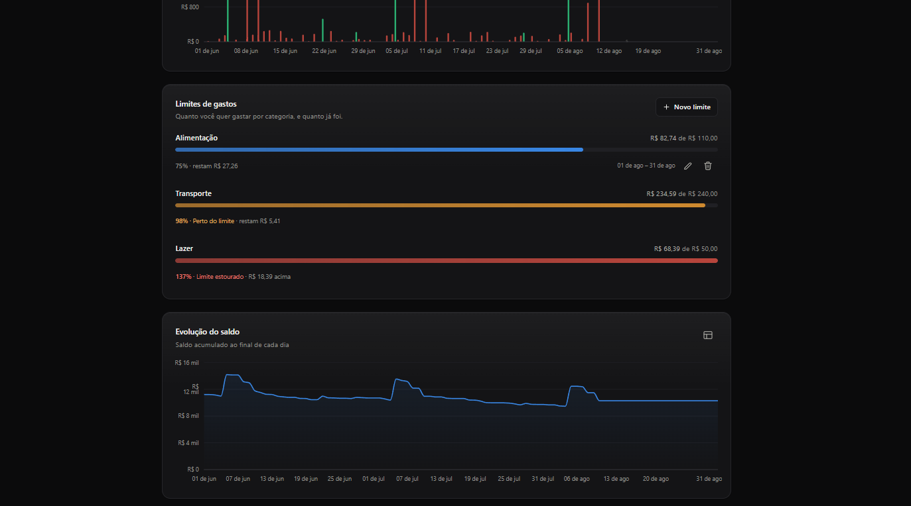

<div align="center">

<picture>
  <source media="(prefers-color-scheme: dark)" srcset="docs/banner-dark.svg">
  
</picture>

### O controle financeiro que cabe no seu dia

Anote o que entra e o que sai, veja para onde o dinheiro está indo<br>
e descubra quanto sobra — sem planilha, sem cadastro, sem nuvem.

**Grátis** · **Sem anúncios** · **Funciona offline** · **Seus dados nunca saem do seu computador**

</div>

---

## O problema que ele resolve

Você sabe quanto ganha. Mas sabe quanto **sobra**? E para onde foi o resto?

A maioria das pessoas descobre isso tarde demais — quando o mês vira e o saldo não bate com a memória. O CIFRA existe para trocar essa surpresa por uma resposta: dois toques para registrar um gasto, e um painel que mostra a verdade sem julgamento.

Nada de conectar o banco, entregar sua senha ou criar mais uma conta. Você anota, ele calcula.

<!--
  CAPTURAS DE TELA — para ligar, apague a primeira e a última linha deste bloco
  (as que abrem e fecham o comentário) e salve os três prints em docs/ com estes
  nomes: painel, análises e histórico.

<div align="center">
  
  
  
</div>

-->

<br>

## O que ele faz

<table>
<tr>
<td width="50%" valign="top">

**Seu saldo, sempre certo**<br>
Nunca é um número digitado à mão. Ele nasce do que você registrou — e se corrige sozinho a cada lançamento.

</td>
<td width="50%" valign="top">

**Registrar leva segundos**<br>
Valor, descrição, categoria, data. Um diálogo rápido que não recarrega a tela nem te faz perder o pensamento.

</td>
</tr>
<tr>
<td width="50%" valign="top">

**Gráficos que explicam**<br>
Entradas contra saídas, a evolução do saldo e para onde o dinheiro foi, dividido por categoria. Tudo também em tabela, para quem prefere números.

</td>
<td width="50%" valign="top">

**Comparação com o mês passado**<br>
"Você gastou 30% a mais em agosto." É o tipo de frase que muda comportamento — e ela aparece sozinha.

</td>
</tr>
<tr>
<td width="50%" valign="top">

**Limites de gasto**<br>
Diga quanto quer gastar com Alimentação por mês. Ao chegar perto do teto, o painel avisa antes de você estourar.

</td>
<td width="50%" valign="top">

**Lançamentos automáticos**<br>
Cadastre o salário e o aluguel uma vez. Todo mês, na data certa, eles se registram sozinhos.

</td>
</tr>
<tr>
<td width="50%" valign="top">

**Compras parceladas**<br>
"Câmera em 10x" vira dez lançamentos mensais numerados. Você vê o compromisso inteiro, mês a mês, em vez de esquecer dele.

</td>
<td width="50%" valign="top">

**Suas contas separadas**<br>
Banco, carteira, poupança — cada uma com o próprio saldo. Mover dinheiro entre elas não conta como gasto, porque não é.

</td>
</tr>
<tr>
<td width="50%" valign="top">

**Leve o extrato com você**<br>
Exporte para o Excel, para outro programa ou como um extrato pronto para imprimir. Seus dados são seus.

</td>
<td width="50%" valign="top">

**Claro ou escuro, no seu ritmo**<br>
Do celular ao monitor grande, com cores escolhidas para serem legíveis por quem enxerga cores de outro jeito.

</td>
</tr>
</table>

<br>

## A conta por trás de tudo

<div align="center">

### saldo de hoje = o que você já tinha + tudo que entrou − tudo que saiu

</div>

Simples assim, e é essa a razão de o número ser confiável: **não existe saldo digitado à mão**. Se algo está errado no total, é porque falta ou sobra um lançamento — e você consegue achar qual.

Mudou de ideia sobre quanto tinha no começo? Basta corrigir: o histórico continua intacto e todo o resto se recalcula na hora.

<br>

## Onde ficam os seus dados

**No seu computador. Só lá.**

Sem servidor, sem conta, sem sincronização, sem "aceite nossos termos". O CIFRA não tem para onde mandar seus dados nem interesse neles — não há anúncio para exibir, nem perfil para vender.

Isso tem um lado prático que vale saber: **o backup é com você**. Copie a pasta de dados de vez em quando, ou use a exportação, e você fica tranquilo mesmo que o computador se perca.

<br>

## Perguntas frequentes

<details>
<summary><strong>Preciso de internet?</strong></summary><br>

Não. Nem para instalar o dia a dia, nem para usar. O app abre e funciona no avião, no sítio, no meio do nada.

</details>

<details>
<summary><strong>Ele acessa minha conta do banco?</strong></summary><br>

Não, e essa é uma escolha, não uma limitação. Você nunca digita senha de banco nem conecta nada. O preço é anotar os gastos; em troca, ninguém além de você vê o que você faz com o seu dinheiro.

</details>

<details>
<summary><strong>Meus dados vão para algum lugar?</strong></summary><br>

Não. Tudo mora num arquivo dentro da pasta do app, no seu computador. Sem nuvem, sem análise, sem rastreamento.

</details>

<details>
<summary><strong>Tem versão para celular?</strong></summary><br>

Ainda não. Hoje o CIFRA roda no computador — mas a tela se adapta bem a telas pequenas, então dá para usar do celular se o app estiver aberto na sua máquina.

</details>

<details>
<summary><strong>É de graça mesmo? Qual é a pegadinha?</strong></summary><br>

É de graça e não tem pegadinha. Sem versão paga, sem recurso bloqueado, sem anúncio. Como nada roda em servidor nenhum, o app não custa nada para existir.

</details>

<details>
<summary><strong>E se eu quiser começar do zero?</strong></summary><br>

Tem um botão para isso em Ajustes. Ele pede que você digite uma palavra de confirmação, justamente porque não dá para desfazer.

</details>

<br>

## Começar a usar

O CIFRA roda na sua própria máquina, então a primeira vez pede uma preparação rápida — depois disso é um clique, para sempre.

**1.** Instale o [Node.js](https://nodejs.org) (uma vez só, no computador)

**2.** Dentro da pasta do CIFRA, rode estes dois comandos:

```
npm install
npm run atalho
```

**3.** Pronto: um atalho **CIFRA** aparece na sua área de trabalho.

Daí em diante é só clicar nele. O app abre sozinho, sem terminal e sem janela preta — e se você mexeu em alguma coisa, ele se atualiza antes de abrir.

<br>

---

<div align="center">

**CIFRA** · feito para uma pessoa acompanhar o próprio dinheiro, sem intermediários

<sub>Curioso sobre como ele funciona por dentro? A documentação técnica está em <a href="docs/tecnico.md">docs/tecnico.md</a>.</sub>

</div>
